

   
  

  <b>Full Stack Developer @ ThriveLab</b> 
  Computer Engineering @ UCA

  <a href="mailto:daniel2019659@gmail.com">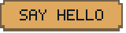</a>
  <a href="https://www.linkedin.com/in/daniel-antonio-melgar-mendez-42152225b/">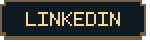</a>
  <a href="https://github.com/AntonioMelgarMendez?tab=repositories">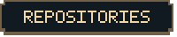</a>

### 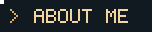

Hi, I'm **Daniel**. I build web and mobile applications at **ThriveLab**, with a particular interest in **backend systems** and **software architecture**. I'm also studying Computer Engineering at **UCA**.

Previously, I worked on mobile development at **Moovit**. Outside work, I experiment with **Jetpack Compose apps** and **interactive web simulators**. Currently exploring Ruby and microservices.

Spanish (native) · English (professional) · French (elementary)

### 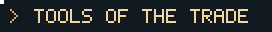

  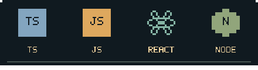
  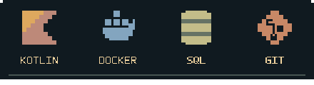

**Web & mobile** — React Native, Jetpack Compose, Tailwind CSS, HTML5, Android Studio. 
**Backend & data** — Express, MongoDB, SQL Server, Oracle, SQLite. 
**Cloud & tools** — AWS, Google Cloud, Postman, Power BI.

More languages I work with

Java, Python, C++, and PHP.

### 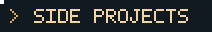

**School Transport Supervision** 
An Android app for monitoring and managing school transportation. 
Kotlin / Jetpack Compose

**Electrical Circuits Simulator** 
An interactive web simulator built for a university social outreach project. 
JavaScript / Web

[See my repositories →](https://github.com/AntonioMelgarMendez?tab=repositories)

### 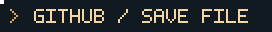

  <a href="https://github.com/AntonioMelgarMendez?tab=repositories">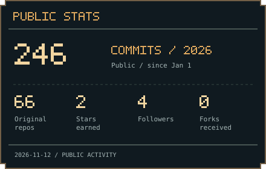</a>
  <a href="https://github.com/AntonioMelgarMendez?tab=repositories">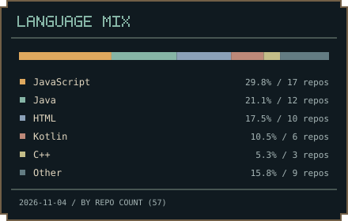</a>

  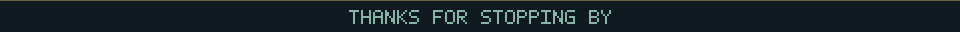

